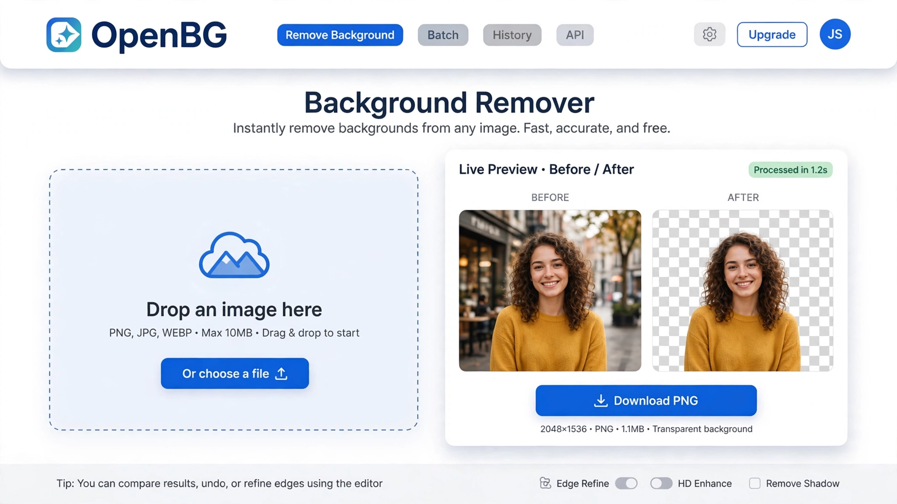

# OpenBG

> A free, open-source, self-hostable **remove.bg** replacement.



*Web UI preview (illustration of the interface, not a live screenshot).*

OpenBG runs the MIT-licensed [BiRefNet](https://github.com/ZhengPeng7/BiRefNet)
ONNX model fully on your own machine using Rust + the ONNX Runtime. It ships as
one binary that can act as a command-line tool, a batch processor, and an HTTP
API server that is wire-compatible with the (now-shutdown) remove.bg API.

- **Free** — no API keys, no signups, no rate limits.
- **Open source** — MIT-licensed, including the model.
- **Self-hosted** — your images never leave your machine.
- **Compatible** — point existing remove.bg client code at OpenBG by changing
  one URL.

---

## Why OpenBG exists

remove.bg's standalone website and self-serve API **shut down on
1 December 2026 at 09:00 CET**. Background removal moved into
[Canva](https://www.canva.com) (behind a Pro subscription) and the API into
[Leonardo.Ai](https://leonardo.ai). Millions of users — students, small
businesses, indie devs, hobbyists — suddenly lost a free, simple tool they had
relied on for years. OpenBG exists so that tool does not simply disappear.

It deliberately uses the **BiRefNet-general** model (MIT-licensed) instead of
rembg's default `RMBG-2.0` model, which is **not free for commercial use**.
BiRefNet is published under the MIT licence by Zheng *et al.* (CAAI AIR'24),
so OpenBG can be used commercially without any licence uncertainty.

---

## Build

You need Rust 1.75 or newer.

```bash
git clone https://github.com/ViraBuilds/openbg.git
cd openbg
cargo build --release
```

The first run will download the ONNX model (~224 MB by default) into your user
cache directory (`~/.cache/openbg` on Linux, `~/Library/Caches/openbg` on macOS,
`%LOCALAPPDATA%\openbg` on Windows). Override the location with
`OPENBG_CACHE_DIR`, and override the model URL with `OPENBG_MODEL_URL`.

The binary ends up at `target/release/openbg`.

---

## Usage

### 1. Command line — single image

```bash
cargo run --release -- remove photo.jpg -o photo-nobg.png
```

Options mirror remove.bg's API fields:

| Flag         | Values                                | Default |
|--------------|---------------------------------------|---------|
| `--size`     | `auto` \| `preview` \| `regular` \| `full` | `auto`  |
| `--format`   | `auto` \| `png` \| `jpg`              | `auto`  |
| `--bg-color` | `#rrggbb` (omit for transparent)      | transparent |

### 2. Command line — batch folder

```bash
cargo run --release -- batch ./input_folder -o ./output_folder
```

Useful flags:

- `--recursive` — descend into subdirectories.
- `--skip-existing` — skip outputs that already exist and are newer than the
  input.

Every supported image in `input_folder` (`png`, `jpg`, `jpeg`, `webp`, `bmp`,
`tif`, `tiff`) is processed in turn, preserving the directory structure in the
output folder.

### 3. HTTP API server + web demo

```bash
cargo run --release -- serve --port 8080
```

Then open <http://localhost:8080/> for the drag-and-drop web demo, or POST to
`http://localhost:8080/v1.0/removebg` from your code.

```bash
curl -s -X POST http://localhost:8080/v1.0/removebg \
  -F "image_file=@photo.jpg" \
  -F "size=auto" \
  -F "format=png" \
  -o photo-nobg.png
```

---

## How the API matches remove.bg

The `POST /v1.0/removebg` endpoint accepts the same multipart/form-data fields
as remove.bg, so existing client code keeps working after changing only the
URL:

| Field         | Type   | Notes                                                                 |
|---------------|--------|-----------------------------------------------------------------------|
| `image_file`  | binary | The image to process. Mutually exclusive with `image_url`.           |
| `image_url`   | string | Fetch the image from a URL.                                           |
| `size`        | string | `auto` (default) \| `preview` \| `full` \| `regular`.                 |
| `format`      | string | `auto` (default) \| `png` \| `jpg` \| `zip` (zip falls back to PNG).  |
| `bg_color`    | string | `#rrggbb` hex colour. Omit for a transparent background.              |

Accepted but ignored headers: `X-Api-Key`, `Accept`. The response body is the
raw image bytes with the matching `Content-Type` (`image/png` or `image/jpeg`),
exactly like remove.bg. The endpoint is on the same origin as the web demo, so
a browser never sends the photo to any third party.

---

## Honest limits

OpenBG is honest about what it is and is not:

- **Quality.** BiRefNet is very good, but slightly worse than remove.bg on
  fine hair, fur and translucent edges. For most photos the difference is hard
  to see; for portraits of curly hair or furry animals it can be visible.
- **Speed.** On CPU, inference takes a few seconds per image. A CUDA-capable
  GPU or Apple Silicon makes it dramatically faster. The first inference per
  process is slower while the runtime warms up the graph.
- **No matting alpha.** OpenBG returns a binary-ish mask (sigmoid of the
  model's output). It is not a true alpha matte; semi-transparent regions are
  quantised. The BiRefNet-matting variants exist for that, but OpenBG ships
  the general model for the best all-round results.
- **No auto-crop, no auto-positioning.** remove.bg offered several output
  sizes that also cropped and re-centred. OpenBG honours `size` only as a
  longest-side cap and preserves the original framing.
- **Model download.** The first run downloads the model. In air-gapped
  environments, set `OPENBG_MODEL_URL` to a local file or mirror, or copy the
  downloaded `birefnet-general-tiny.onnx` into the cache directory yourself.

---

## Default model

| Property   | Value |
|------------|-------|
| Name       | `BiRefNet-general-bb_swin_v1_tiny-epoch_232.onnx` |
| Size       | ~224 MB |
| Licence    | MIT |
| Source     | <https://github.com/ZhengPeng7/BiRefNet/releases> |
| Input      | RGB image, resized to 1024×1024, normalised with ImageNet mean/std |
| Output     | Sigmoid mask at 1024×1024, resized back to the original resolution |

To use a different BiRefNet ONNX export (e.g. the full `BiRefNet-general` at
~972 MB for the highest quality, or the fp16 variant), set
`OPENBG_MODEL_URL` to the release URL of your choice.

---

## Project layout

```
openbg/
├── Cargo.toml
├── LICENSE
├── README.md
├── static/
│   └── index.html          # Drag-and-drop web demo (calls the local API)
└── src/
    ├── main.rs             # Binary entry point
    ├── lib.rs              # Crate root
    ├── cli.rs              # remove / batch / serve subcommands
    ├── server.rs           # axum HTTP API + static demo
    ├── model.rs            # First-run model download + cache
    └── engine.rs           # ONNX Runtime inference, pre/post-processing
```

---

## Licence

OpenBG is licensed under the **MIT License** — see [`LICENSE`](LICENSE).
The bundled model weights (BiRefNet-general, tiny Swin-v1 backbone) are also
MIT-licensed by their authors. The ONNX Runtime binaries that `ort`
downloads at build time are MIT-licensed by Microsoft.

---

## Donate

OpenBG is free and MIT-licensed. If it saves you a subscription, donations
are very welcome:

- **TON:** `UQAdlJHWw-2wkhmYEQDVb-bfsNdwKEFfF5T4MtuBSw5GJrdD`
- **EVM (Ethereum/BSC/Polygon):** `0xf38cAF0757B611fD625cA2c392b24D79025D62c9`

Thank you.
